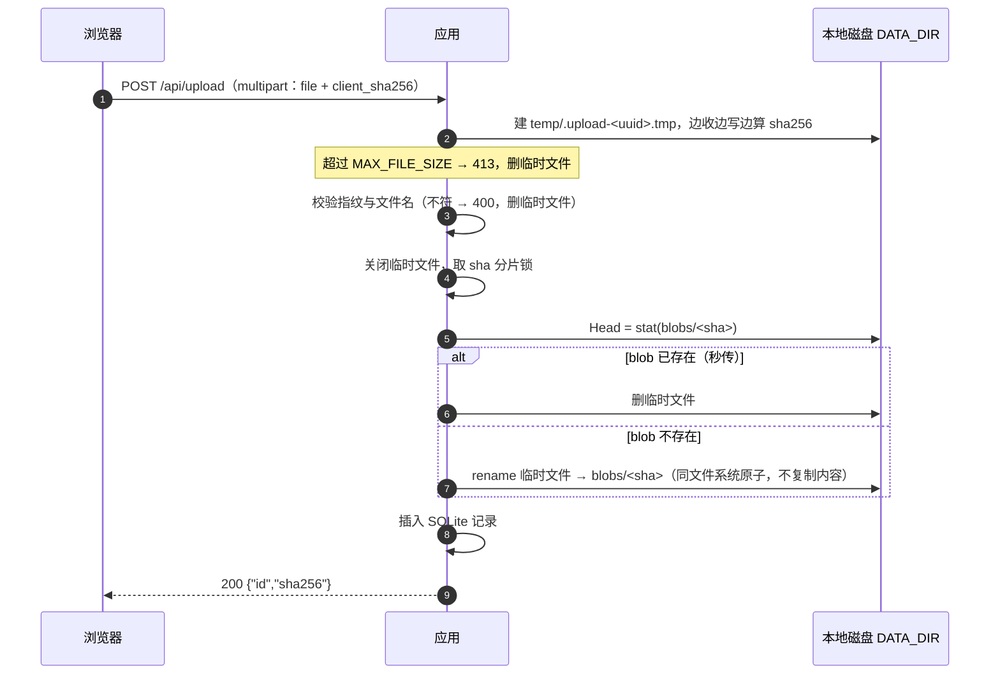
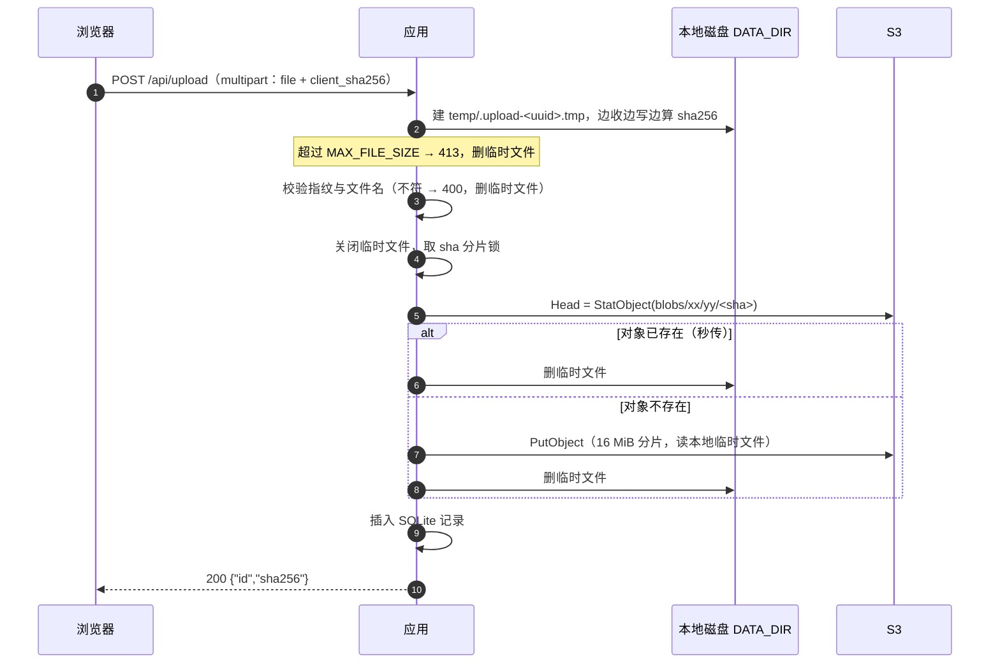
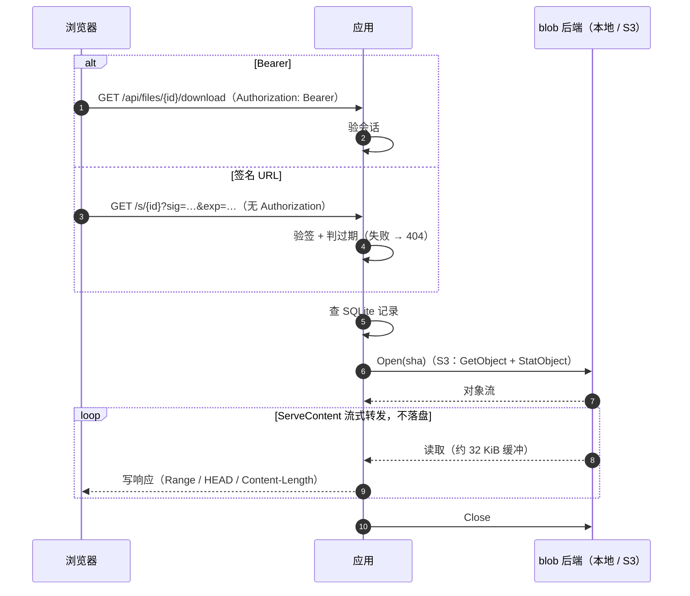

# file-share 设计

本文件由用户主导。当前内容由 Lead 依据实现起草（用户已授权先起草再审改）；
实现与本文不一致处按缺陷处理。

## 1. 概述

自托管的文件分享服务：上传后按 SHA-256 内容寻址去重（秒传），可收藏、可用文件夹整理、可下载、可生成 10 分钟或 24 小时有效的签名分享链接（免登录下载）。
交付物是单个静态链接的 Go 二进制，前端构建产物经 `go:embed` 编入。
运行期状态只有两处：`DATA_DIR`（SQLite、上传暂存、默认的 blob 目录）与可选的 S3 桶。

技术栈：Go 1.27.4（标准库 `net/http` + `modernc.org/sqlite` + `golang.org/x/crypto`
+ `minio-go/v7`）、Vue 3 + Vite + TypeScript；前端在 `frontend/`，产物固定为 `frontend/dist`。
容器优先，面向 Podman（`podman kube play` / systemd Quadlet）。

## 2. 部署

- 镜像 `ghcr.io/hm-service/file-share:<yyyy-MM-dd>` / `:latest`；多阶段 Dockerfile
  （node 构建前端 → Go 编译 → alpine 只留一个二进制），同时构建 amd64 与 arm64。
- blob 后端：默认本地 `DATA_DIR/blobs/<sha256>`；配 `S3_ENDPOINT` 后写 S3，
  对象 key 为 `blobs/xx/yy/<sha256>`（`S3_PREFIX` / `S3_BUCKET` 可改）。两套实现由
  `app.BlobStore` 隔离，上传、秒传、下载、删除与引用计数语义一致。
- `k8s.file-share.yaml`：Pod + PVC + ConfigMap + Secret；`readOnlyRootFilesystem: true`、
  `capabilities.drop: [ALL]`；探针 `/livez`、`/readyz?token=<READYZ_TOKEN>`。
- 容器以 root 运行：`DATA_DIR` 必须可写（PVC / 具名卷默认满足；宿主机 bind mount 需先处理属主，
  否则收紧权限会因缺少 `CAP_FOWNER` 失败）。`file-share.kube` 是 Podman Quadlet 模板
  （`Yaml=./k8s.%p.yaml`）。

## 3. 环境变量与 Secret

| 变量 | 默认 | 校验 / 说明 |
| --- | --- | --- |
| `HOST` | `0.0.0.0` | IP 或合法主机名；监听地址 |
| `PORT` | `8080` | 1–65535 |
| `TZ` | 空（Go 默认） | 合法时区名；影响日志时间戳 |
| `DATA_DIR` | `/data` | SQLite、上传暂存 `temp/` 与本地 blob 目录 `blobs/`；必须已存在且可读写，启动时收紧到 0700 |
| `TRUSTED_PROXIES` | `127.0.0.1/32,::1/128` | 逗号分隔 CIDR/IP；只信任这些来源的 `X-Forwarded-For` |
| `MAX_AUTH_CONCURRENCY` | `32` | `/api/auth` 信号量槽位，≥ 1 |
| `MAX_API_CONCURRENCY` | `128` | 其余 `/api/*` 槽位，≥ 1 |
| `MAX_STATIC_CONCURRENCY` | `64` | 静态资源与 `/s/{id}` 槽位，≥ 1 |
| `MAX_FILE_SIZE` | `2GiB` | 单文件上限；纯整数按字节，支持 `GiB`/`MiB` 后缀 |
| `S3_ENDPOINT` | 空 | `http(s)://host[:port]`，不带路径 / 查询；为空即本地目录，此时其它 `S3_*` 必须为空 |
| `S3_BUCKET` | `file-share` | 桶名；必须已存在，启动时校验 |
| `S3_PREFIX` | `blobs` | 对象 key 前缀，`/` 分隔的段只含 `A-Za-z0-9._-` |
| `S3_REGION` | `us-east-1` | 签名区域；自建网关任意值即可 |
| `S3_ACCESS_KEY` / `S3_SECRET_KEY` | 无（S3 模式必填） | Secret；可打印 ASCII，不能含空白；读完从环境表删除 |
| `GOMEMLIMIT` | — | 交给 Go 运行时，应用不读取 |
| `SESSION_SIGNING_KEY` | 无，**必填** | Secret；32–128 字符同上；会话 HMAC 密钥，轮换即全部下线 |
| `URL_SIGNATURE_KEY` | 无，**必填** | Secret；32–128 字符同上；签名 URL 的 HMAC 密钥，轮换即已签链接失效 |
| `READYZ_TOKEN` | 空 | 空表示 `/readyz` 不设门槛；非空时 16–128 字符同上 |

数值 / 主机 / 端口 / 时区写错直接拒绝启动（exit 1），不做静默降级。

### 3.1 用户表

用户表固定在 `DATA_DIR/users.yaml`，是一份 YAML，结构对齐 SeaweedFS 的 s3 config：身份列表 + 权限数组。
用户表在启动时加载校验（任一字段不合法即拒绝启动），运行期只读，改表要重启。

```yaml
users:
  - name: admin
    password: "change_me"
    permissions: [read, write]
  - name: guest
    password: "guest_password_123"
    permissions: [read]
```

- 名字 1–64 位 `[A-Za-z0-9._-]`、以字母或数字开头、全局唯一；密码 8–256 字节明文保存，
  文件权限建议 0600；权限只允许 `read` / `write`，至少一项。
- `read` 覆盖浏览、统计、下载、签分享链接；`write` 覆盖上传（含秒传预检）、收藏、
  重命名 / 移动 / 删除文件、新建 / 重命名 / 删除 / 排序文件夹。
- 会话凭据只带用户名（见 §7），请求时按当前用户表解析权限：删掉用户即等于吊销其会话。

## 4. 数据目录与表结构

```
DATA_DIR/                   0700
  file-share.db             0600  SQLite（WAL 模式）
  file-share.db-wal/-shm          WAL 附带文件
  blobs/                    0700  本地模式下的 blob 目录（S3 模式为空）
    <sha256>                0600  内容寻址的物理文件
  users.yaml                     用户表（容器部署时由 Secret 挂进来）
  temp/                     0700  上传暂存
    .upload-*.tmp                 上传中的临时文件，启动时清理残留
```

S3 模式下 `blobs/` 为空，
blob 存在桶里：`<S3_PREFIX>/<sha 前 2 位>/<sha 第 3-4 位>/<sha>`。
两种模式下同一内容都只存一份，删除记录时若该 sha 已无引用则删除 blob。

```sql
CREATE TABLE IF NOT EXISTS file (
  id          TEXT    PRIMARY KEY,          -- uuid4，32 位小写十六进制
  filename    TEXT    NOT NULL,             -- 展示名 / 下载名，仅 basename，<= 255 字节
  sha256      TEXT    NOT NULL,             -- 内容指纹，64 位小写十六进制
  size        INTEGER NOT NULL,             -- 字节数
  is_favorite INTEGER NOT NULL DEFAULT 0,   -- 0/1
  group_path  TEXT    NOT NULL DEFAULT '',  -- 文件夹路径 1~3 段，空串 = 未分组
  sort_order  INTEGER NOT NULL DEFAULT 0,   -- 升序
  created_at  INTEGER NOT NULL              -- unix 秒
);
CREATE INDEX IF NOT EXISTS file_sha256_idx ON file (sha256);

CREATE TABLE IF NOT EXISTS groups (
  path       TEXT    PRIMARY KEY,          -- 文件夹完整路径
  parent     TEXT    NOT NULL,             -- 父路径，空串 = 一级
  name       TEXT    NOT NULL,             -- 路径最后一段
  sort_order INTEGER NOT NULL,             -- 同一父级内升序
  UNIQUE (parent, name)
);
```

- 单库单连接（`SetMaxOpenConns(1)`），无外键，一致性由代码保证。
- `PRAGMA user_version = 6`；旧库启动时在事务内逐级迁移，更高版本拒绝启动；
  更旧的 Python 数据（`files.db` / `favorite.json`）也拒绝启动。升级前备份 `DATA_DIR`。
- 列表排序 `sort_order ASC, created_at DESC, id ASC`；上传 / 秒传插入时取 `MAX+1`。
- 文件夹最多三级，空文件夹也保留，每级都有自己的页面。
  改名 / 删除按路径前缀处理全部后代（同一事务）；删除文件夹时组内文件可上移到父路径或一并删除。
- 收藏状态全局（服务只有一个凭据身份）。

## 5. 页面

| 路径 | 页面 | 说明 |
| --- | --- | --- |
| `/` | 最近 | 跨文件夹按上传时间倒序，只列最近 20 个 |
| `/favorites` | 收藏 | 全部收藏文件 |
| `/ungrouped` | 未分组 | `group_path` 为空的文件 |
| `/<一级>`、`/<一级>/<二级>`、`/<一级>/<二级>/<三级>` | 文件夹 | 内容区列出该文件夹的子文件夹与直属文件 |
| `/auth` | 登录页 | 输入用户名与密码换取会话 |

- 桌面端是「左侧文件夹树 + 右侧内容区表格 + 右下角上传队列」；窄屏把文件夹树收进抽屉，
  表格只保留名称与操作列。桌面端可拖动两栏边界调节文件夹树宽度（200px ～ 视口一半，
  宽度只存本次会话，刷新后回到默认；窄屏隐藏分隔条）；侧栏与内容区的滚动条常驻槽位并落在内边距里，
  不压住列表行。
- 文件夹树：快捷入口（最近 / 收藏 / 未分组）+ 最多三级的文件夹树（空文件夹也显示，行尾是
  子树文件数）；展开 / 折叠状态存 `localStorage`。右键或节点操作的「⋯」打开菜单
  （统计信息、重命名、新建子文件夹、删除）。
- 内容区表格列为名称、大小、上传时间（`created_at`）、指纹（8 位短 SHA-256）、操作：子文件夹行在前（显示子树项数），
  文件行在后；移动端隐藏大小、时间、指纹三列。
  文件行操作是「下载、复制分享链接、收藏、移动到文件夹、更多（重命名 / 复制 curl / 删除）」，
  点文件名打开详情（含完整 SHA-256）。顶部面包屑逐级可点回上层。
- 拖拽：文件夹行与文件行各用一个独立的 SortableJS 列表。文件夹行只在同级文件夹之间排序
  （提交 `PUT /api/groups/order`，失败回滚），永远排在文件之前；文件行在同一文件夹内排序
  （提交 0..n-1 的 `sort_order`，失败回滚）；文件拖到左侧文件夹或内容区的文件夹行上 = 移动到
  该文件夹；外部文件拖到内容区 = 上传到当前文件夹，拖到某个文件夹上 = 上传到该文件夹。
- 上传队列在右下角：显示实时速度、可取消 / 重试；入队时用列表接口下发的 `max_file_size`
  提前拒绝超限文件（服务端 413 兜底），成功后把记录移进入队时所在的文件夹。
- 文件夹视图提供「全部下载（X GiB）」：按可见顺序逐个签 10 分钟有效的 `/s/{id}?sig&exp`
  再逐个触发，每个文件是独立下载（不打包）。
- 搜索是全局的：跨全部文件夹按文件名过滤（写进 `?q=`），结果行内标出所在文件夹；
  搜索期间禁用拖拽排序。
- 前端两个 HTML 入口（`index.html` / `auth.html`），不引入路由库：视图与路径手写映射，
  `pushState` / `popstate` 还原前进后退，超过三段 404，未知文件夹回退「最近」；文案走 i18n
  （简中 / English）。未登录跳 `/auth?next=`，接口 401 时清会话再跳转。

## 6. 接口

错误响应统一为 `{"detail": "<按 Accept-Language 本地化的文案>"}`；登录后用
`Authorization: Bearer <session>`。

### 6.1 认证

| 方法 | 路径 | 说明 |
| --- | --- | --- |
| POST | `/api/auth` | `{"token"}` → `200 {"token":"<session>","expires_at":<unix>}`；错误 400/401/405 |

- 原始凭据只出现在 `/api/auth`；校验有 1–1.2 秒最小耗时，防时序侧信道。
- 会话：`base64url("<exp>|<nonce>") + "." + base64url(HMAC-SHA256(SESSION_SIGNING_KEY, "v1|"+payload))`，
  nonce 16 字节，有效期 30 天；先验签名再验过期。
- 无状态会话不可单独撤销，只能轮换密钥让全部下线；退出登录由前端清除凭据。

### 6.2 文件（均需登录）

| 方法 | 路径 | 说明 |
| --- | --- | --- |
| GET | `/api/files` | `{"files":[…],"groups":[…],"max_file_size":<int64>}`；文件按 `sort_order` 升序、创建时间倒序；`groups` 含空文件夹 |
| GET | `/api/storage` | 当前 blob 方案：`{"backend":"local"}` 或 `{"backend":"s3","bucket","prefix"}`，外加实时探测的 `healthy` 与不可用时的 `error` 文案；不含 endpoint 与凭据 |
| POST | `/api/check_file` | 秒传预检（multipart：`client_sha256`、`filename`）：命中则建记录并返回 `{"exists":true,"id","filename","size"}`，否则 `{"exists":false}` |
| POST | `/api/upload` | multipart：`file` + `client_sha256`；流式落盘并校验 SHA-256，成功 `{"id","sha256"}`，超限 413 |
| PATCH | `/api/files/{id}` | 重命名 / 改文件夹 `{"filename","group_path"}`（至少一个，空串 = 未分组，改文件夹移到末尾） |
| POST | `/api/groups` | 新建空文件夹 `{"path"}`（1~3 段），201；已存在 409 |
| POST | `/api/groups/rename` | 重命名最后一段并改写全部后代 `{"path","new_name"}`，204；目标已存在 409 |
| POST | `/api/groups/delete` | 删除文件夹及后代 `{"path","delete_files"}`；`false` 时文件上移到父路径，204 |
| PUT | `/api/groups/order` | 保存某层顺序 `{"parent","names"}`（须覆盖该父级全部文件夹），204；集合不符 409 |
| PUT | `/api/files/order` | 批量排序 `{"items":[{"id","sort_order"}]}`（1..2000 项），204；任一 id 不存在整批 404 |
| POST | `/api/files/{id}/favorite` | 切换收藏，返回 `{"is_favorite":bool}` |
| GET | `/api/files/{id}/download` | 登录态下载附件（支持 Range / HEAD） |
| GET | `/api/files/{id}/download-url` | 签浏览器下载地址 `{"url":"/s/{id}?sig=…&exp=…"}` |
| POST | `/api/files/{id}/share` | 签分享链接，同上；`ttl` 可选 600（默认）/ 86400，其它值 400 |
| DELETE | `/api/files/{id}` | 删除记录；无引用后删 blob；204 |

上传约束：字段顺序不限，边收边算哈希；同内容并发只存一份 blob、各留一条记录；取消上传由前端中止，服务端按失败路径清理临时文件（见 §6.4）。

### 6.3 匿名下载（无需登录）

| 方法 | 路径 | 说明 |
| --- | --- | --- |
| GET | `/s/{file_id}?sig=…&exp=…` | 凭签名下载（支持 Range / HEAD）；无效 / 过期一律 404 |

`sig = base64url(HMAC-SHA256(URL_SIGNATURE_KEY, "v1|<method>|<escapedPath>|<exp>"))`，
`escapedPath` 不含查询参数，URL 固定 `sig` 在前、`exp` 在后。先验签再判过期，
签名覆盖方法与路径。下载地址固定 10 分钟；分享链接可选 10 分钟或 24 小时（`ttl` 只认这两档），
格式相同、用途不同；
与会话凭据密钥隔离，访问日志只记 `/s/{file_id}`。

### 6.4 上传与下载链路

两种 blob 后端语义一致，区别只在临时文件如何变成 blob。后端故障（连不上、凭据失效、桶被删、
本地 blob 目录丢失）在业务层统一回 503 `storage.unavailable`，与「服务器内部错误」区分开；
对象不存在仍是 404。`/api/storage` 每次请求实时探测后端（S3 探桶、本地确认 blob 目录），
响应带 `healthy` 与不可用时的 `error`，侧栏底部的存储提示据此变红；同处显示当前用户，
只读账号挂「只读」徽标。

上传先完整写本地临时文件：
`multipart` 字段顺序不固定，且要边收边算哈希、超限早拒，请求结束才决定临时文件留不留。
同一 sha 的「Head + 落位 + 插记录」由 64 路 sha 分片锁串行，网络 IO 不占 `App.mu`；
落库用不带取消信号的 ctx，避免客户端断连让已收完的内容落库半途而废。

#### 上传 · 本地目录



#### 上传 · S3



秒传预检 `POST /api/check_file` 只做 `Head`：命中则补一条记录、不传内容。

#### 下载

接口按权限分两类：读接口要求 `read`，写接口要求 `write`（只读账号调用写接口回 403）。
下载入口有两个：`GET /api/files/{id}/download`（Bearer）与 `GET /s/{id}?sig&exp`（签名 URL），
最终都汇到 `Blobs.Open` + `http.ServeContent`。`download-url` / `share` 是「先签后下」的签发段：
只签发地址，签发前用 `Blobs.Head` 确认记录与对象都在（缺失 404），不传输内容。



- 下载不落本地磁盘、不进内存：`Open` 返回文件句柄或 S3 响应体，`ServeContent` 边读边写回。
- S3 模式在 `Open` 里先 `StatObject`：对象丢失时在写响应头之前就 404，而不是流到一半才断。
- 文件名由记录决定：`Content-Disposition` 用 `mime.FormatMediaType`，非 ASCII 名走 RFC 2231
  的 `filename*`；HEAD 与 Range 归一为同一个签名校验。

| 步骤 | 本地目录 | S3 |
| --- | --- | --- |
| 上传暂存 | `DATA_DIR/temp/.upload-*.tmp`（两种模式都有） | 同左 |
| 存在性 `Head` | `os.Stat` | `StatObject` |
| 落位 `PutFile` | rename 到 `blobs/`（同文件系统） | `PutObject` 后删临时文件 |
| 打开 `Open` | `os.Open` | `GetObject` + `StatObject` |
| 删除 `Delete` | `os.Remove` | `RemoveObject` |
| 启动检查 | 无 | `BucketExists`，桶不存在拒绝启动 |

### 6.5 探针

| 方法 | 路径 | 说明 |
| --- | --- | --- |
| GET | `/livez` | 进程活着就 200；无闸门、不记日志 |
| GET | `/readyz` | 校验数据目录 / 数据库权限与读写（`__probe` 表）；`READYZ_TOKEN` 非空时需 `?token=`；失败 503，原因只进日志 |

## 7. 安全模型

- 认证：用户表（`DATA_DIR/users.yaml`）里的用户名 + 明文密码。密码比较用 SHA-256 摘要 + 恒定时间比较，
  用户名不存在也走同一路径，并统一补足最小登录耗时，避免用耗时区分「用户不存在」与「密码错误」。
- 授权：`/api/*` 除 `POST /api/auth` 外均需会话；匿名访问只通过 `/s/{id}?sig&exp`，
  绑定单文件、10 分钟或 24 小时失效、不是会话凭据、不进日志。
- Secret（会话密钥、URL 密钥、探针令牌、S3 凭据）读完立即从进程环境表删除；用户表文件不落环境变量内容。
- 数据权限：`DATA_DIR` 0700、`blobs/` 与 `temp/` 0700、数据库 0600、本地 blob 与上传临时文件 0600，启动时收紧，
  `/readyz` 持续断言；S3 模式改用桶凭据控制访问。
- 响应头：`X-Content-Type-Options: nosniff`、`Referrer-Policy: no-referrer`、
  `X-Frame-Options: DENY`、严格 CSP
  （`default-src 'none'; script-src 'self'; style-src 'self' 'unsafe-inline'; img-src 'self' data:; connect-src 'self'; font-src 'self'; object-src 'none'; base-uri 'self'; form-action 'self'; frame-ancestors 'none';`）。
- 输入上限：登录 JSON 4 KiB、其它 JSON 64 KiB、排序 256 KiB（≤ 2000 项）、秒传表单 1 MiB、
  上传 `MAX_FILE_SIZE`；文件名只取 basename 并校验长度 / 字符；文件夹路径最多三级，
  每段 trim 后 ≤ 64 字节、不含控制字符与 `/`、不是 `.` / `..`、不以 `.html` 结尾，
  一级段不与站点已有路径（`api`、`auth`、`favorites` 等）重名。
- 并发闸门：认证、业务 API、静态资源 / 签名下载各自独立信号量。
- 反代职责：TLS、限流、访问控制在反向代理完成；应用只信任 `TRUSTED_PROXIES` 内的转发头。
- 日志：结构化 JSON 到 stdout，一条请求一行，含真实客户端 IP 与 RFC 3339 时间；敏感值不落日志。

## 8. 构建与验证

- `just check`（gofmt / vet / test + 前端 typecheck）、`just build`（前端构建 + 交叉编译到
  `.dist/app-<os>-<arch>`）、`just run`、`just stop`。
- 二进制用 `CGO_ENABLED=0 -ldflags="-w -s" -trimpath` 构建，`ldd` 应报 `not a dynamic executable`。
- 测试：标准库 `testing`，表格驱动；`internal/testenv` 提供临时 `DATA_DIR` 实例；
  覆盖认证 / 会话、上传秒传与去重、签名 URL、探针、错误路径、安全头与 i18n，覆盖率记入 README。
  S3 用例（Range 上传下载、秒传、引用计数删除、迁移、启动校验）需 `S3_TEST_*`，
  未配置时整组 skip，CI 默认不跑。
- 前端验证：构建后用无头 Chromium 截图并检查控制台错误；关键截图存 `docs/` 并在 README 引用。

## 9. 已知取舍

- 权限只有粗分的 `read` / `write`；收藏是全局状态，没有按用户隔离。
- 会话不可单独撤销；分享链接在有效期内无法提前撤销、不记访问次数，需要更细粒度时再引入分享表。
- 文件夹最多三级；移动文件只能通过行内菜单或把行拖到文件夹上，跨文件夹的拖拽排序未实现。
- 文件与文件夹的排序都只在同一父级内拖拽提交相对顺序，不跨级拖动；搜索期间禁用拖拽。
- 结构变更只在启动时一次性迁移，不做运行期兼容分支；旧 Python 数据不迁移。
- S3 是可选外部依赖：配置后 S3 不可用会导致上传 / 下载失败（启动时桶检查直接 fail-fast）；
  对象存储自身的部署、备份、复制与监控由部署方负责。
- 多实例共用一个桶时必须使用不同 `S3_PREFIX`：引用计数在各实例自己的 SQLite 里，
  共享前缀会让一个实例删掉另一个实例还在引用的对象。
- 本地目录 → S3 的切换不做自动迁移：停服后由运维用任意工具把 `blobs/` 按 `<前缀>/<sha 前 2 位>/<sha 第 3-4 位>/<sha>` 传到桶里，
  再配 `S3_*` 重启；本地 `blobs/` 在确认稳定后自行清理。