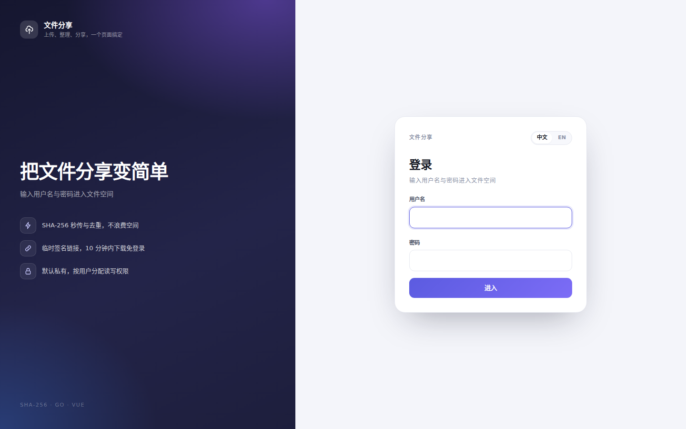
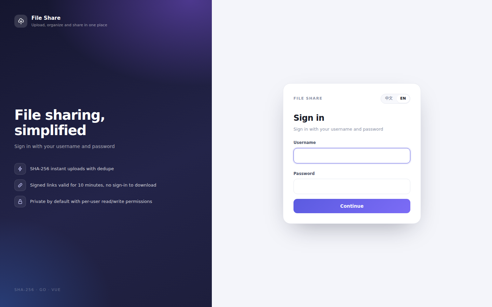
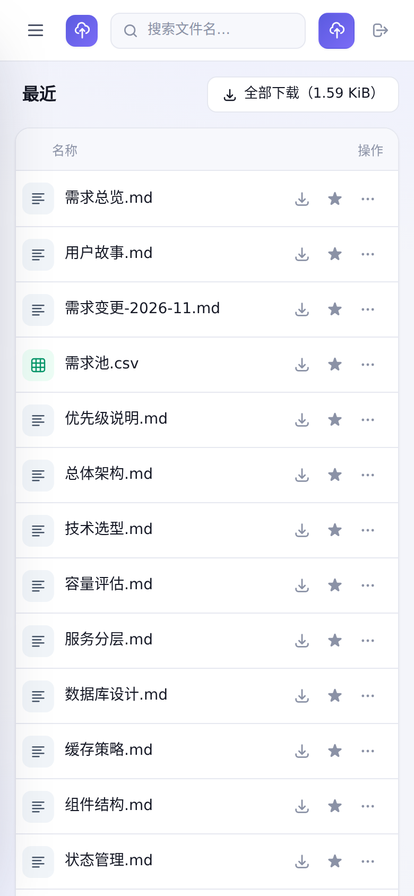
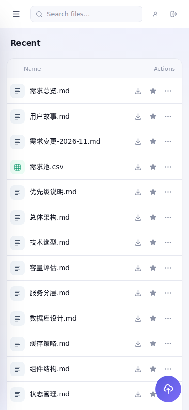

# file-share

自托管的**只读**文件浏览前端：单二进制、目录即分组、不需要数据库。数据源是同一台机器上
samba 共享的只读目录（`samba-data` 卷里的 `daveny/`），页面只做浏览、搜索、收藏、下载与
签名分享链接，不持有文件副本、不写文件内容。后端 Go（标准库 `net/http` + `yaml`），
前端 Vue 3 + Vite + TypeScript，前端构建产物通过 `go:embed` 编进二进制。

## 界面

| 登录页（中文） | 主界面（中文） |
| --- | --- |
|  |  |

| 登录页（English） | Main page (English) |
| --- | --- |
|  |  |

| 移动端（中文） | 移动端（English） |
| --- | --- |
|  |  |

## 功能

- **只读浏览**：目录即分组、文件即文件，目录深度不限制；空目录也显示，行尾是子树文件数。
  每次列表请求实时扫描只读目录，SMB 侧增删文件刷新即见，不做同步。
- **目录树与列表**：桌面端左侧是快捷入口（全部 / 最近 / 收藏）与目录树（展开 / 折叠状态记在浏览器本地，
  首次打开默认展开到第二级）；右侧内容区是当前目录的表格，子目录行在前、文件行在后，
  列为名称、大小、修改时间、操作。顶部搜索全局按文件名过滤（写进 `?q=`）。
- **下载与分享**：文件行可下载、复制 10 分钟 / 24 小时分享链接；当前视图可「下载全部」
  （逐个签 10 分钟有效的签名地址并触发下载，不打包成 zip）。分享链接是签名 URL，
  对方免登录即可下载，过期或改路径都会失效。
- **收藏**：每个用户一份本地元数据 `DATA_DIR/favorites/<用户名>.json`，不碰只读数据目录；
  需要 `fav` 权限（没有时界面不显示星标与收藏入口）；「收藏」视图列出该用户收藏的文件。
- **用户、权限与可见范围**：用户表固定放在数据目录 `DATA_DIR/users.yaml`。`permissions` 支持
  `read`（浏览 / 下载 / 分享）与 `fav`（收藏）；`access` 是可见范围数组（`["/"]` 表示整个数据目录，
  `["/目录A"]` 表示只显示该目录，多值取并集），未授权目录与文件直接从视图里消失，但路径仍显示
  数据目录下的完整位置。登录用用户名 + 密码换 30 天会话，除 `/api/auth` 外的 `/api/*` 都需要
  `Authorization: Bearer`。未登录打开深链接会先跳登录页，登录后回到原地址（含搜索词）。
- **中英双语**：前端文案可切换，后端错误文案按 `Accept-Language` 本地化。
- **响应式工作台**：桌面为左侧目录树 + 内容区表格；≤900px 把目录树收进抽屉，表格只保留名称与操作列，
  「下载全部」收进右下角悬浮按钮；窄屏禁用页面缩放，列表支持下拉刷新。
- **单文件交付**：静态链接的 Go 二进制（amd64/arm64），容器以只读根文件系统、丢弃全部 capabilities 运行，
  数据卷只读挂载。

## 快速开始

需要 Go 1.27.4、Node 26.13.0、pnpm 12.21.0、`just`。

```bash
export DATA_DIR=./.data                     # 可写数据目录：用户表 + 收藏元数据
export FILES_DIR=./.scratch/files           # 只读数据目录（测试时指向任意目录）
mkdir -p "$DATA_DIR" "$FILES_DIR"
cat > "$DATA_DIR/users.yaml" <<'EOF'        # 用户表：固定放在数据目录，改完重启生效
users:
  - name: admin
    password: change_me_please
    permissions: [read, fav]
    access: ["/"]
EOF
export SESSION_SIGNING_KEY=change_me_please_1234567890  # 32-128 位 [A-Za-z0-9_]
export URL_SIGNATURE_KEY=change_me_please_0987654321   # 32-128 位 [A-Za-z0-9_]
export READYZ_TOKEN=optional_readyz_token              # 可选
just run
```

打开 <http://127.0.0.1:8080>，在 `/auth` 输入用户表里的用户名与密码登录。
停止服务：`just stop`（按端口定位本项目进程并发送 SIGINT）。

`DATA_DIR` 未设置时默认 `/data`、`FILES_DIR` 默认 `/data/files`；本地 `just run` 会建好 `./.data` 并传入。

## 环境变量

| 变量 | 默认 | 说明 |
| --- | --- | --- |
| `DATA_DIR` | `/data` | 可写数据目录：用户表与收藏元数据；必须已存在，启动时收紧到 0700。 |
| `FILES_DIR` | `/data/files` | 只读数据根目录；必须已存在且可读。 |
| `TRUSTED_PROXIES` | 空 | 逗号分隔的 CIDR，用于取客户端 IP。 |
| `SESSION_SIGNING_KEY` | 无（必填） | 会话 HMAC 密钥，32–128 位 `[A-Za-z0-9_]`。 |
| `URL_SIGNATURE_KEY` | 无（必填） | 签名 URL 的 HMAC 密钥，32–128 位 `[A-Za-z0-9_]`。 |
| `READYZ_TOKEN` | 空 | 非空时 `/readyz` 要求 `?token=` 一致。 |
| `HOST` / `PORT` | `0.0.0.0` / `8080` | 监听地址。 |
| `TZ` | 空 | 设了必须是有效的时区名。 |
| `MAX_AUTH_CONCURRENCY` / `MAX_API_CONCURRENCY` / `MAX_STATIC_CONCURRENCY` | 32 / 128 / 64 | 三组请求的信号量槽位。 |

用户表固定读 `DATA_DIR/users.yaml`：`permissions` 取 `read` / `fav`（`fav` 必须同时带 `read`），
`access` 是可见范围数组，条目必须是数据目录下已存在的目录（`"/"` 表示整个数据目录）；
大小写敏感：配置写 `/DOCS` 就只认 `/DOCS`，与实际目录名不一致时启动失败。
受限账号看到的路径仍是数据目录下的完整路径，不会以授权目录为根重写。

## 构建

```bash
just frontend   # 安装依赖并把前端构建到 frontend/dist
just build      # 构建前端 + 交叉编译 .dist/app-<os>-<arch>（linux/amd64、linux/arm64）
just check      # gofmt / vet / go test / 前端 typecheck（提交前必跑）
```

## 容器与部署

```bash
podman kube play k8s.file-share.yaml
```

- 两个 PVC：`file-share-data`（`DATA_DIR`，可写）与 `samba-data`（SMB 共享的数据卷，只读）。
- `FILES_DIR=/samba/daveny`：容器内 `/samba` 是只读挂载的 `samba-data` 卷，`daveny/` 就是
  SMB 共享里 daveny 用户的目录。
- `users` Secret 以 subPath 挂成 `/data/users.yaml`；改用户表要重启 Pod。
- 镜像由 CI（`.github/workflows`）构建并推到 GHCR 与 ACR；front 上 `podman pull` 后重建 Pod。
- `/livez` 永远 200；`/readyz` 检查 `DATA_DIR` 可写与 `FILES_DIR` 可读，可配 `READYZ_TOKEN`。

## 接口速览

| 方法 | 路径 | 说明 |
| --- | --- | --- |
| POST | `/api/auth` | 用户名 + 密码换会话，返回 `{token, expires_at, user}`。 |
| GET | `/api/me` | 当前用户、权限与可见范围：`{name, permissions, access}`。 |
| GET | `/api/files` | 当前用户可见范围内的文件与目录：`{files, groups}`。 |
| GET | `/api/storage` | 只读目录与收藏元数据是否可用：`{backend:"dir", healthy, error?}`。 |
| PUT / DELETE | `/api/favorites?path=` | 收藏 / 取消收藏（需要 `read + fav`），返回 `{is_favorite}`。 |
| POST | `/api/share` | body `{"path","ttl":"10m"|"24h"}`，返回 `{url}`。 |
| GET | `/api/download-url?path=` | 签一个 10 分钟有效的下载地址，返回 `{url}`。 |
| GET | `/s/<相对路径>?sig=&exp=` | 匿名下载入口；签名覆盖转义后的路径。 |
| GET | `/livez`、`/readyz` | 存活 / 就绪探针。 |

**下载与分享**：页面内下载先调用 `/api/download-url` 换一个 10 分钟有效的 `/s/...` 地址，
再让浏览器导航下载（流式、可续传、原生进度都在浏览器侧）。「复制分享链接（10 分钟）」签
`ttl=600`，「复制分享链接（24 小时）」签 `ttl=86400`；接口只认这两档，其它值返回 400。
路径里的中文、空格、括号按逐段百分号编码，签名覆盖的就是这个转义路径。

## 数据与升级

```
DATA_DIR/
  users.yaml                用户表（登录与可见范围的唯一依据，改完重启）
  favorites/<用户名>.json   该用户的收藏元数据（应用维护，{"paths":[...]}）
FILES_DIR/         只读数据目录：SMB 共享的内容，应用只扫描不修改
```

- 不再有 SQLite、blob 目录与上传暂存；只读视图不保存文件内容。
- 收藏记录与文件解耦：SMB 侧删掉文件后收藏记录仍在，读取时自然匹配不到、不显示。
- 升级前备份 `DATA_DIR`（用户表与收藏）即可；数据目录本身由 SMB 共享负责备份。
- `recent` 与 `favorites` 是保留的一级路径：顶级目录恰好叫这两个名字时会与对应视图冲突
  （已知限制，只读视图不改数据目录）。

## 目录结构

```
main.go       入口：环境变量 → 应用容器 → 路由 → 监听 / 优雅关闭
web.go        go:embed frontend/dist，页面与静态资源
api/          HTTP 层：路由、中间件、认证、浏览/收藏/下载接口、探针
app/          用例层：只读目录扫描、路径安全、收藏元数据、签名 URL
core/         纯逻辑：会话签名、签名 URL、随机数、文件权限
httpx/        JSON 响应、错误、客户端 IP
i18n/         后端中英文案表
frontend/     Vue 3 + Vite + TypeScript，构建产物 frontend/dist
internal/     测试脚手架（临时 DATA_DIR / FILES_DIR + 测试服务）
docs/         README 引用的截图
```

## 测试

```bash
just test     # go test ./... -count=1
just check    # gofmt/vet/go test + 前端 typecheck
```

Go 测试覆盖：`app`（目录扫描任意深度 / 隐藏文件照常展示 / 符号链接 / 可见范围与祖先链 / 收藏按用户隔离 /
路径校验 / 签名 URL）、`api`（列表、收藏与 fav 权限、分享、下载、401/404/405）、
`main`（环境变量解析、站点外壳）。
本地验收：`FILES_DIR` 指向测试目录起服务，用 Playwright 走「登录 → 目录 → 搜索 → 收藏 → 下载 →
分享链接 → 移动端」。

## License

GPL-3.0，见 [LICENSE](LICENSE)。