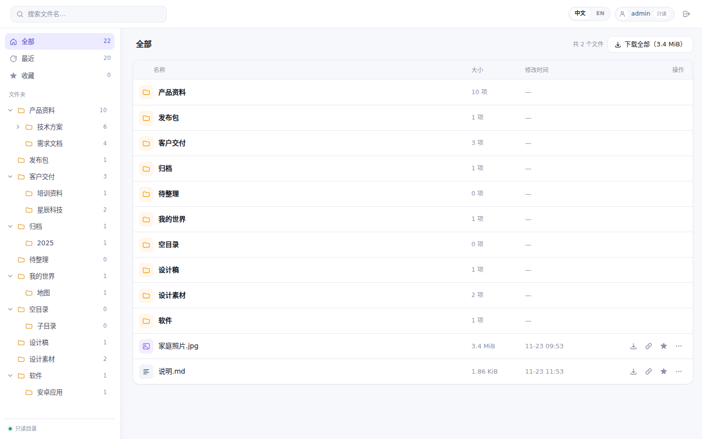
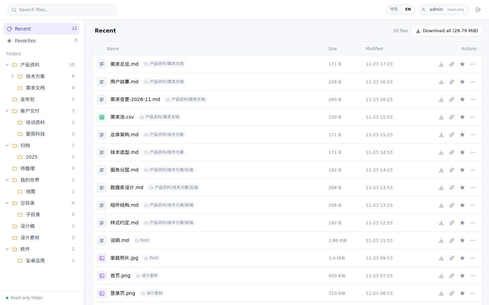

# file-share

自托管的轻量文件分享服务：单二进制、SQLite、内容寻址秒传、收藏与可签发 10 分钟 / 24 小时有效期的签名分享链接。
后端 Go（标准库 `net/http` + `modernc.org/sqlite` + `minio-go`），前端 Vue 3 + Vite + TypeScript，
前端构建产物通过 `go:embed` 编进二进制。运行期状态是 `DATA_DIR`（SQLite、上传暂存与本地 blob）；
物理文件默认存 `DATA_DIR/blobs`，配置 S3 后改存 S3 兼容对象存储，应用本身仍是无状态单二进制。

## 界面

| 登录页（中文） | 主界面（中文） |
| --- | --- |
|  |  |

| 登录页（English） | Main page (English) |
| --- | --- |
|  |  |

| 移动端（中文） | 移动端（English） |
| --- | --- |
|  |  |

## 功能

- **秒传与去重**：文件按 SHA-256 内容寻址；本地算指纹 → 服务端预检 → 命中即秒传，物理文件只存一份（本地 `DATA_DIR/blobs` 或 S3，见「环境变量」）。
- **上传与拖放**：点击「上传文件」或把文件拖到内容区即可上传；拖到左侧文件夹树或内容区的文件夹行上时直接传进该文件夹。右下角上传队列显示指纹计算 / 秒传预检 / 上传进度与实时速度，支持取消与重试；单个文件上限由 `MAX_FILE_SIZE` 控制（默认 2GiB），上限随列表接口下发，超限文件在入队时就被拦下（不计算指纹、不发请求），服务端 413 是最后一道防线。
- **文件夹树与文件列表**：桌面端左侧是快捷入口（最近 / 收藏 / 未分组）与最多三级的文件夹树，展开 / 折叠状态记在浏览器本地；右侧内容区是当前文件夹的表格，子文件夹行在前、文件行在后，列为名称、大小、上传时间、指纹（8 位短 SHA-256，悬停看完整值）、操作。文件行操作是「下载、复制分享链接（10 分钟）、收藏、移动到文件夹、更多（24 小时分享链接 / 重命名 / 复制 curl / 删除）」，点文件名打开详情（含完整 SHA-256）。当前文件夹可「全部下载（X GiB）」：按可见顺序逐个签 10 分钟有效的签名地址并触发下载（不打包成 zip）。顶部搜索全局按文件名过滤（写进 `?q=`），结果行内标出所在文件夹。
- **文件夹管理与拖拽**：文件夹最多三级、空文件夹也保留，每级都有自己的页面（`/<一级>`、`/<一级>/<二级>`、`/<一级>/<二级>/<三级>`），地址可刷新、可前进后退、可直接打开。右键文件夹或点「⋯」可查看统计信息（文件数量、总大小与大小分布）、重命名、新建子文件夹、删除（确认框可勾选「同时删除这些文件」，否则组内文件上移到父路径）。文件行可在同一文件夹内拖拽排序（`sort_order` 持久化到服务端），拖到文件夹上即移动到该文件夹；文件夹行也可拖拽排序（`PUT /api/groups/order`），且只排在同级文件夹之间——文件夹永远在文件之前；「最近」是固定时间序，不参与拖拽。新建文件夹时输入 `父/子/孙` 可一次建多层（父级不存在会一并创建）。
- **单 token 登录**：输入 `AUTH_TOKEN` 换取 30 天会话；所有 `/api/*` 需要 `Authorization: Bearer`。未登录打开深链接会先跳登录页，登录后回到原地址（含搜索词）。
- **中英双语**：前端文案可切换，后端错误文案按 `Accept-Language` 本地化。
- **响应式工作台**：桌面为左侧文件夹树 + 内容区表格 + 右下角上传队列；≤900px 把文件夹树收进抽屉，表格只保留名称与操作列。
- **单文件交付**：静态链接的 Go 二进制（amd64/arm64），容器以只读根文件系统、丢弃全部 capabilities 运行。

## 快速开始

需要 Go 1.27.4、Node 26.13.0、pnpm 12.21.0、`just`。

```bash
export DATA_DIR=./.data
export AUTH_TOKEN=change_me_please          # 16-128 位 [A-Za-z0-9_]
export SESSION_SIGNING_KEY=change_me_please_1234567890  # 32-128 位 [A-Za-z0-9_]
export URL_SIGNATURE_KEY=change_me_please_0987654321   # 32-128 位 [A-Za-z0-9_]
export READYZ_TOKEN=optional_readyz_token   # 可选
export MAX_FILE_SIZE=2GiB                   # 可选：单文件上限，默认 2GiB（也支持 MiB / 纯字节）
# 可选：物理文件存 S3 兼容对象存储（不配 S3_ENDPOINT 时存本地 DATA_DIR/blobs；桶必须已存在）
export S3_ENDPOINT=http://127.0.0.1:8333
export S3_BUCKET=file-share                 # 默认 file-share
export S3_ACCESS_KEY=change_me_access_key
export S3_SECRET_KEY=change_me_secret_key
# S3_PREFIX 默认 blobs；对象 key 为 blobs/<sha前2>/<sha3-4>/<sha>
just run
```

打开 <http://127.0.0.1:8080>，在 `/auth` 输入 `AUTH_TOKEN` 登录。
停止服务：`just stop`（按端口定位本项目进程并发送 SIGINT）。

`DATA_DIR` 未设置时默认 `/data`（容器内由卷挂载）；本机 `just run` 会建好 `./.data` 并传入。

## 环境变量

| 变量 | 默认 | 说明 |
| --- | --- | --- |
| `HOST` / `PORT` | `0.0.0.0` / `8080` | 监听地址与端口 |
| `TZ` | 空（Go 默认） | 日志时区，设置时必须是合法时区名 |
| `DATA_DIR` | `/data` | 数据目录（SQLite、上传暂存 `temp/` 与本地 blob 目录 `blobs/`）；必须已存在且可读可写 |
| `TRUSTED_PROXIES` | `127.0.0.1/32,::1/128` | 可信反向代理来源，只有这些来源的转发头才被采信 |
| `MAX_AUTH_CONCURRENCY` / `MAX_API_CONCURRENCY` / `MAX_STATIC_CONCURRENCY` | `32` / `128` / `64` | 三组独立并发闸门 |
| `MAX_FILE_SIZE` | `2GiB` | 单个上传文件上限；纯整数按字节，支持 `GiB`/`MiB` 后缀（大小写不敏感） |
| `S3_ENDPOINT` | 空 | 对象存储地址（`http://host:port` 或 `https://…`）；为空时 blob 存本地 `DATA_DIR/blobs`，其余 `S3_*` 也必须为空 |
| `S3_BUCKET` | `file-share` | 桶名；启动时校验，不存在则拒绝启动 |
| `S3_PREFIX` | `blobs` | 对象 key 前缀；最终 key 为 `<前缀>/<sha 前 2 位>/<sha 第 3-4 位>/<sha>` |
| `S3_REGION` | `us-east-1` | 签名区域；自建网关通常任意值即可 |
| `S3_ACCESS_KEY` / `S3_SECRET_KEY` | 无 | S3 凭据（Secret）；允许 `+ / =` 等可打印字符，读完从环境表删除 |
| `AUTH_TOKEN` | 无，必填 | 登录令牌（Secret） |
| `SESSION_SIGNING_KEY` | 无，必填 | 会话签名密钥（Secret），轮换即所有会话下线 |
| `URL_SIGNATURE_KEY` | 无，必填 | 签名 URL 密钥（Secret），轮换即所有已签出的下载 / 分享链接失效 |
| `READYZ_TOKEN` | 空 | 非空时 `/readyz` 需要 `?token=` |

完整校验规则与安全模型见 [DESIGN.md](DESIGN.md)。

## 构建

```bash
just check   # gofmt/vet/go test + 前端 typecheck
just build   # 构建前端 + 交叉编译 linux/amd64、linux/arm64 到 .dist/
```

产物是 `.dist/app-linux-<arch>`：纯静态链接（`CGO_ENABLED=0 -ldflags="-w -s" -trimpath`），
`ldd` 应报告 `not a dynamic executable`。

## 容器与部署

```bash
docker build -t file-share .
podman kube play k8s.file-share.yaml
```

- `k8s.file-share.yaml`：Pod + PVC + ConfigMap + Secret；探针 `/livez` 与 `/readyz?token=…`，
  容器以只读根文件系统、丢弃全部 capabilities 运行。
- `file-share.kube`：Podman Quadlet 模板（systemd 单元）。
- CI（`.github/workflows/build-and-push-docker-image.yml`）在 push 到 `main` 时跑 Go/前端测试，
  并推送 `linux/amd64` + `linux/arm64` 镜像：日期 tag 与 `latest` 各一份（GHCR 与阿里云 ACR）。
  首次部署前把 Secret 里的 `AUTH_TOKEN` / `SESSION_SIGNING_KEY` / `URL_SIGNATURE_KEY` / `READYZ_TOKEN` 换成随机值。
- 用 S3 存 blob：ConfigMap 加 `S3_ENDPOINT` / `S3_BUCKET`（默认 `file-share`）/
  `S3_PREFIX`（默认 `blobs`）/ `S3_REGION`，Secret 加 `S3_ACCESS_KEY` / `S3_SECRET_KEY`；
  桶要提前建好（启动时校验）。
  应用与 S3 同机时，Pod 用 `hostNetwork: true` 即可让 `S3_ENDPOINT=http://127.0.0.1:8333`
  直连宿主上的对象存储（普通桥接网络里容器内的 127.0.0.1 不是宿主）。
  **多实例共用一个桶时每个实例必须配不同 `S3_PREFIX`**：引用计数是各实例自己 SQLite 里的，
  共享前缀会让一个实例删掉另一个实例还在引用的对象。
- 从本地目录切 S3：停服 → `./app.bin migrate-blobs --dry-run` 核对 → `./app.bin migrate-blobs`
  （按 sha 去重上传，逐个校验 sha256 与大小，可重复执行）→ 加 S3 配置重启。
  迁移不删本地文件，回滚就是去掉 `S3_*` 重启。
- 镜像不设 `USER`，容器以 root 运行（配合 `readOnlyRootFilesystem` + `capabilities.drop: [ALL]`）。
  `DATA_DIR` 必须对容器用户可写：PVC / 具名卷默认满足；若用宿主机 bind mount，请先把该目录的属主
  或权限交给容器用户，否则启动时收紧权限（chmod 0700/0600）会因缺少 `CAP_FOWNER` 而失败。

## 接口速览

| 方法 | 路径 | 说明 |
| --- | --- | --- |
| `POST` | `/api/auth` | 用 `AUTH_TOKEN` 换会话 |
| `GET` | `/api/files` | 文件列表、全部文件夹（含空文件夹）与单文件上传上限（`max_file_size`） |
| `GET` | `/api/storage` | 当前 blob 存放方案（本地 / S3 桶与前缀）与后端可达性（`healthy`） |
| `POST` | `/api/check_file` | 秒传预检 |
| `POST` | `/api/upload` | 上传（流式校验 SHA-256） |
| `POST` | `/api/files/{id}/favorite` | 切换收藏 |
| `POST` | `/api/files/{id}/share` | 签分享链接（`?ttl=600` 默认 / `86400` 两档，其它值 400；`{"url":"/s/{id}?sig=…&exp=…"}`） |
| `PATCH` | `/api/files/{id}` | 重命名 / 设置文件夹路径（`filename`、`group_path`，至少给一个） |
| `POST` | `/api/groups` | 新建空文件夹（`path`，`父/子/孙` 表示层级） |
| `POST` | `/api/groups/rename` | 重命名文件夹最后一段（`path`、`new_name`） |
| `POST` | `/api/groups/delete` | 删除文件夹（`path`、`delete_files`），子文件夹级联 |
| `PUT` | `/api/groups/order` | 保存某一层文件夹的顺序（`parent`、`names`） |
| `PUT` | `/api/files/order` | 批量保存拖拽后的顺序（`sort_order`） |
| `GET` | `/api/files/{id}/download` | 登录下载（curl / 程序用） |
| `GET` | `/api/files/{id}/download-url` | 签浏览器下载地址（10 分钟有效） |
| `GET` | `/s/{id}?sig=…&exp=…` | 凭签名下载单个文件（无需登录凭据） |
| `DELETE` | `/api/files/{id}` | 删除 |
| `GET` | `/livez` / `/readyz` | 存活 / 就绪探针 |

`/api/*` 的错误体统一为 `{"detail": "…"}`，详情与鉴权规则见 [DESIGN.md](DESIGN.md)。

### 上传接口

登录后所有请求带 `Authorization: Bearer <session>`。上传分两步：先按客户端 SHA-256 预检（命中秒传），
未命中再流式上传，服务端边收边算哈希并比对。

**1. 秒传预检** `POST /api/check_file`（`multipart/form-data`，体上限 1 MiB）

| 字段 | 说明 |
| --- | --- |
| `client_sha256` | 客户端算出的 SHA-256，64 位小写十六进制 |
| `filename` | 文件名（仅 basename，<= 255 字节） |

```bash
curl -s -H "Authorization: Bearer $SESSION" \
  -F "client_sha256=$SHA256" -F "filename=报告.pdf" \
  http://127.0.0.1:8080/api/check_file
# 命中（已建好记录）：{"exists":true,"id":"3f2c…","filename":"报告.pdf","size":123}
# 未命中：{"exists":false}
```

**2. 上传** `POST /api/upload`（`multipart/form-data`）

| 字段 | 说明 |
| --- | --- |
| `file` | 文件内容；文件名取该 part 的 `filename` |
| `client_sha256` | 同预检；与客户端指纹不一致返回 400 |

字段顺序不限。请求体上限为 `MAX_FILE_SIZE + 1 MiB`，单文件超过 `MAX_FILE_SIZE`（默认 2GiB）返回 413。
成功返回 `{"id":"3f2c…","sha256":"…"}`；失败统一为 `{"detail":"…"}`：
400（缺字段 / 指纹格式 / 文件名 / 校验不符）、401（未登录）、413（超过 `MAX_FILE_SIZE`）。

```bash
curl -s -H "Authorization: Bearer $SESSION" \
  -F "file=@报告.pdf" -F "client_sha256=$SHA256" \
  http://127.0.0.1:8080/api/upload
# {"id":"3f2c…","sha256":"e3b0c442…"}
```

### 文件夹与排序接口

文件夹是独立记录：完整路径、父路径与同一层内的顺序存在 `groups` 表，空文件夹也保留；文件上的
`group_path` 指向文件夹（`"工作"`、`"工作/项目A"` 或 `"工作/项目A/阶段一"`），空串表示未分组。
最多三级，每级都有自己的页面；同级排序用 `sort_order`。

文件夹路径的每一段同时是页面路径的一段（`/<一级>`、`/<一级>/<二级>`、`/<一级>/<二级>/<三级>`），
因此每段都不能含 `/`、不能是 `.` / `..`、不能以 `.html` 结尾；一级段还不能与站点已有路径重名
（`api`、`s`、`auth`、`assets`、`readyz`、`livez`、`favorites`、`ungrouped`、`favicon.svg`）。

**设置文件夹**：`PATCH /api/files/{id}`，JSON `{"group_path":"工作/项目A"}`（每段 trim 后 ≤64 字节，空串=移出文件夹）。
成功返回完整文件对象，并自动移到列表末尾；非法路径 400，文件不存在 404。

```bash
curl -s -X PATCH -H "Authorization: Bearer $SESSION" -H 'Content-Type: application/json' \
  -d '{"group_path":"工作/项目A"}' http://127.0.0.1:8080/api/files/3f2c…
```

**重命名文件**：同一个 `PATCH /api/files/{id}`，JSON `{"filename":"新名字.pdf"}`（仅 basename，≤255 字节）。
成功返回完整文件对象，顺序不变；文件名为空 / 含路径分隔符或控制字符 400，文件不存在 404。
`filename` 与 `group_path` 可以一起给；一个字段都不给是 400（没有要改的东西就别发请求）。

```bash
curl -s -X PATCH -H "Authorization: Bearer $SESSION" -H 'Content-Type: application/json' \
  -d '{"filename":"新名字.pdf"}' http://127.0.0.1:8080/api/files/3f2c…
```

**重命名文件夹**：`POST /api/groups/rename`，JSON `{"path":"工作/项目A","new_name":"项目B"}`。
只改路径最后一段，父路径与同级位置不变；改名时全部后代文件夹与组内文件路径一起跟着改。
组内记录的 `sort_order` 不变；目标文件夹已存在时返回 409（不做隐式合并），源文件夹不存在返回 404，
非法段名返回 400。成功返回 `204`。

```bash
curl -s -X POST -H "Authorization: Bearer $SESSION" -H 'Content-Type: application/json' \
  -d '{"path":"工作","new_name":"工作区"}' http://127.0.0.1:8080/api/groups/rename
```

**新建文件夹**：`POST /api/groups`，JSON `{"path":"工作/项目A"}`；成功 `201 {"path":"工作/项目A"}`，
已存在返回 409、非法段名 / 超过三级返回 400。新文件夹追加到同一父级的末尾，可以没有文件；
父级不存在时一并创建。

```bash
curl -s -X POST -H "Authorization: Bearer $SESSION" -H 'Content-Type: application/json' \
  -d '{"path":"工作/项目A"}' http://127.0.0.1:8080/api/groups
```

**删除文件夹**：`POST /api/groups/delete`，JSON `{"path":"工作","delete_files":false}`；成功 `204`。
全部后代文件夹一并删除。`delete_files` 为 `false` 时组内文件上移到被删文件夹的父路径（一级文件夹上移到未分组），
为 `true` 时连记录一起删、`sha256` 不再被引用的物理文件同时清理。文件夹不存在返回 404。

```bash
curl -s -X POST -H "Authorization: Bearer $SESSION" -H 'Content-Type: application/json' \
  -d '{"path":"工作","delete_files":false}' http://127.0.0.1:8080/api/groups/delete
```

**文件夹排序**：`PUT /api/groups/order`，JSON `{"parent":"","names":["二组","一组"]}`。
`parent` 是父文件夹路径（一级用空串），`names` 必须是该层全部文件夹的名字（含空文件夹）；
成功返回 `204`，集合对不上返回 409（提示刷新后重试），重复 / 空名 / 空白名返回 400。

```bash
curl -s -X PUT -H "Authorization: Bearer $SESSION" -H 'Content-Type: application/json' \
  -d '{"parent":"","names":["二组","一组"]}' http://127.0.0.1:8080/api/groups/order
```

**拖拽排序**：`PUT /api/files/order`，按新顺序提交同一文件夹内的文件（前端用 0..n-1 编号）：

```json
{"items":[{"id":"3f2c…","sort_order":0},{"id":"8a1b…","sort_order":1}]}
```

成功返回 `204`；重复 id、不存在的 id、非法序号 → 400/404 且整批回滚。该接口请求体上限 256 KiB（最多 2000 项）。

### 下载接口

curl / 程序可以直接带 Bearer 调 `GET /api/files/{id}/download`。浏览器里的下载按钮走签名 URL：
先 `GET /api/files/{id}/download-url`（需登录）拿到 `{"url":"/s/{id}?sig=…&exp=…"}`，
再让浏览器直接下载该地址。地址 10 分钟内有效、只绑定单个文件；下载路径不要求 `Authorization`，因此可以流式传输、支持 Range 与浏览器原生进度，
也不会把会话 token 写进地址栏或日志。

**分享链接**：行内「复制分享链接」会先 `POST /api/files/{id}/share`（需登录）拿到
`{"url":"/s/{id}?sig=…&exp=…"}`，拼上站点 origin 后复制；链接只绑定单个文件，对方免登录即可下载。
有效期有两档：行内按钮签 10 分钟档（`?ttl=600`，不传也是这档），「更多」菜单里的
「复制分享链接（24 小时）」签 `?ttl=86400`；接口只认这两档，其它值返回 400。

「更多」菜单里的「复制 curl 命令」也使用这张签名地址，得到
`curl -f -o '<文件名>' '<origin>/s/{id}?sig=…&exp=…'`：粘到终端就把文件按原名下载到当前目录；
`-f` 保证链接过期或文件删除时直接失败，不会把 404 的错误响应存成文件。

**文件夹「全部下载」**：在当前文件夹点按钮后，前端按当前可见（搜索之后）的文件顺序对每个文件各签一个下载地址、各触发一次下载
（不打包成 zip）。浏览器首次通常会询问是否允许本站下载多个文件，允许后整批文件会逐个保存；
这些下载都是独立的，可以分别取消或续传。

## 数据与升级

```
DATA_DIR/
  file-share.db          SQLite（WAL）
  blobs/<sha256>         本地模式下的内容寻址物理文件（S3 模式为空）
  temp/                  上传暂存（两种模式都用；启动时清理 .upload-*.tmp）
```

旧版本把 blob 放在 `DATA_DIR/files`：启动时自动改名为 `DATA_DIR/blobs`，
两个目录同时存在则拒绝启动，需要人工确认哪份是有效数据后再启动。

配置 S3 后，物理文件写成 `<S3_PREFIX>/<sha 前 2 位>/<sha 第 3-4 位>/<sha>`
（默认桶 `file-share`、默认前缀 `blobs`，即 `blobs/xx/yy/<sha256>`）；对象内容与记录里的
sha256 一一对应，去重与引用计数逻辑不变。界面侧栏底部会显示当前存储后端（本地磁盘或
S3 桶与前缀），方便运维确认实际生效的配置。
S3 模式下备份要同时覆盖 SQLite 与桶：对象与记录可能短暂不一致，恢复后以记录为准，
多余的对象只是孤儿、不影响服务；本地文件在确认稳定前不要删。

当前 schema 为 `user_version = 6`（v2 新增 `group_name` / `sort_order`，v3 引入文件夹顺序，
v4 把 `group_order` 升级为文件夹注册表 `groups`，v5 让文件夹支持两级并把 `group_name` 改名
`group_path`，v6 删掉 `is_public` 列）。当前允许三级文件夹只放宽了校验，不需要新的 schema 版本。
启动时旧库在事务内逐级迁移（v1 → … → v6）：v4 的文件夹名不含 `/`，迁移后都成为一级文件夹，路径保持不变。
更高版本会拒绝启动。检测到更旧的 Python 版本数据（`files.db` / `favorite.json`）仍要求清空 `DATA_DIR`。
升级前先备份 `DATA_DIR`。用 S3 存 blob 时还要备份桶（或对象存储自身的快照）。

本地目录 → S3 的一次性迁移：

```bash
./app.bin migrate-blobs --dry-run   # 只检查本地文件与记录，不写对象存储
./app.bin migrate-blobs             # 上传缺失对象；已存在且大小一致的跳过
```

迁移要求停写（停服或只读窗口），只上传不删除；切换后确认稳定再由运维清理本地 `blobs/`。

## 目录结构

```
main.go       入口：环境变量 → 应用容器 → 路由 → 监听 / 优雅关闭
migrate.go    运维子命令：把本地 blob 一次性迁移到 S3
web.go        go:embed frontend/dist，页面与静态资源
api/          HTTP 层：路由、中间件、认证、文件接口、探针
app/          用例层：启动一次性工作、上传编排、文件操作
core/         纯逻辑：会话签名、Argon2id、UUID、校验、文件权限
db/           SQLite：打开、建表、查询（SQL 只在这里）
httpx/        JSON 响应、错误、客户端 IP
i18n/         后端中英文案表
frontend/     Vue 3 + Vite + TypeScript，构建产物 frontend/dist
internal/     测试脚手架（临时 DATA_DIR + 测试服务）
docs/         README 引用的截图
```

## 测试

```bash
just test    # go test ./... -count=1
# S3 集成测试（默认 skip；给测试专用桶与凭据后跑）
S3_TEST_ENDPOINT=http://127.0.0.1:8333 S3_TEST_BUCKET=blobs \
  S3_TEST_ACCESS_KEY=… S3_TEST_SECRET_KEY=… just test-s3
just check   # gofmt/vet/go test + 前端 typecheck
```

覆盖率实测（`go test ./... -cover`）：

| 包 | 覆盖率 |
| --- | --- |
| `main`（仓库根） | 71.2% |
| `api` | 87.7% |
| `app` | 55.1% |
| `core` | 95.0% |
| `db` | 74.1% |
| `httpx` | 90.6% |
| `i18n` | 100.0% |
| `internal/testenv` | —（纯测试脚手架，无测试文件） |

实测命令：`go test ./... -cover -count=1`（Go 1.27.4，2026-11-21）。
`app` 里包含 S3 blob 后端，S3 用例默认 skip、不计入上面的覆盖率；配置 `S3_TEST_*` 后由 `just test-s3` 另外覆盖。

## License

GPL-3.0，见 [LICENSE](LICENSE)。
