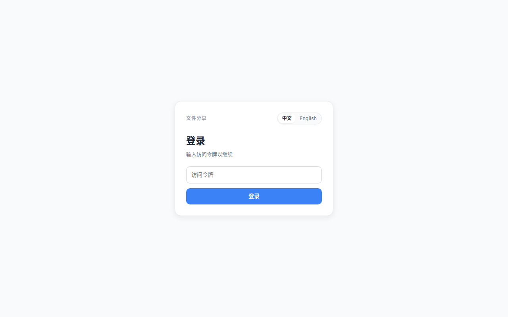
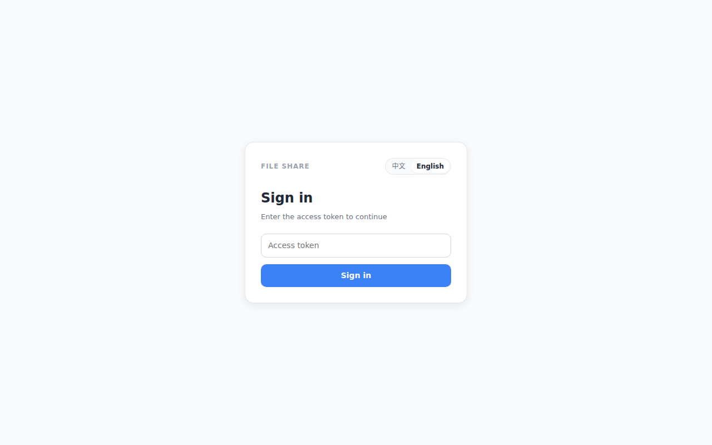
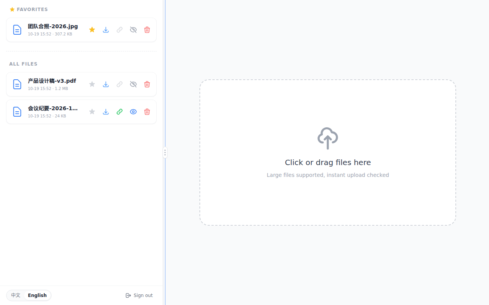

# file-share

自托管的轻量文件分享服务：单二进制、SQLite、内容寻址秒传、收藏与公开直链。
后端 Go（标准库 `net/http` + `modernc.org/sqlite`），前端 Vue 3 + Vite + TypeScript，
前端构建产物通过 `go:embed` 编进二进制，运行期唯一的状态是 `DATA_DIR`。

## 界面

| 登录页（中文） | 主界面（中文） |
| --- | --- |
|  |  |

| 登录页（English） | Main page (English) |
| --- | --- |
|  |  |

## 功能

- **秒传与去重**：文件按 SHA-256 内容寻址；本地算指纹 → 服务端预检 → 命中即秒传，物理文件只存一份。
- **上传队列**：拖拽或选择多文件，串行上传，显示指纹计算 / 预检 / 上传进度，失败可移除。
- **收藏与公开**：左侧收藏区与全部文件列表；每个文件可切换收藏、公开/私有；公开后可用匿名直链下载。
- **单 token 登录**：输入 `AUTH_TOKEN` 换取 30 天会话；所有 `/api/*` 需要 `Authorization: Bearer`。
- **中英双语**：前端文案可切换，后端错误文案按 `Accept-Language` 本地化。
- **可调节布局**：侧栏与主区之间的分隔条可拖拽（或聚焦后用左右方向键）调整宽度，双击恢复默认；占比存在 `localStorage`。
- **单文件交付**：静态链接的 Go 二进制（amd64/arm64），容器以只读根文件系统、丢弃全部 capabilities 运行。

## 快速开始

需要 Go 1.27.2、Node 26.7.0、pnpm 11.28.5、`just`。

```bash
export DATA_DIR=./.data
export AUTH_TOKEN=change_me_please          # 16-128 位 [A-Za-z0-9_]
export SESSION_SIGNING_KEY=change_me_please_1234567890  # 32-128 位 [A-Za-z0-9_]
export READYZ_TOKEN=optional_readyz_token   # 可选
just run
```

打开 <http://127.0.0.1:8080>，在 `/auth` 输入 `AUTH_TOKEN` 登录。
停止服务：`just stop`（按端口定位本项目进程并发送 SIGINT）。

`DATA_DIR` 未设置时默认 `/data`（容器内由卷挂载）；本机 `just run` 会建好 `./.data` 并传入。

## 环境变量

| 变量 | 默认 | 说明 |
| --- | --- | --- |
| `HOST` / `PORT` | `127.0.0.1` / `8080` | 监听地址与端口 |
| `TZ` | 空（Go 默认） | 日志时区，设置时必须是合法时区名 |
| `DATA_DIR` | `/data` | 数据目录（SQLite + 物理文件）；目录必须已存在且可读可写 |
| `TRUSTED_PROXIES` | `127.0.0.1/32,::1/128` | 可信反向代理来源，只有这些来源的转发头才被采信 |
| `MAX_AUTH_CONCURRENCY` / `MAX_API_CONCURRENCY` / `MAX_STATIC_CONCURRENCY` | `32` / `128` / `64` | 三组独立并发闸门 |
| `MAX_UPLOAD_BYTES` | `8589934592` | 单次上传体上限（8 GiB） |
| `AUTH_TOKEN` | 无，必填 | 登录令牌（Secret） |
| `SESSION_SIGNING_KEY` | 无，必填 | 会话签名密钥（Secret），轮换即所有会话下线 |
| `READYZ_TOKEN` | 空 | 非空时 `/readyz` 需要 `?token=` |

完整校验规则与安全模型见 [DESIGN.md](DESIGN.md)。

## 构建

```bash
just check   # gofmt/vet/go test + 前端 typecheck
just build   # 构建前端 + 交叉编译 linux/amd64、linux/arm64 到 .dist/
```

产物是 `.dist/app-linux-<arch>`：纯静态链接（`CGO_ENABLED=0 -ldflags="-w -s" -trimpath`），
`ldd` 应报告 `not a dynamic executable`。

## 容器与部署

```bash
docker build -t file-share .
podman kube play k8s.file-share.yaml
```

- `k8s.file-share.yaml`：Pod + PVC + ConfigMap + Secret；探针 `/livez` 与 `/readyz?token=…`，
  容器以只读根文件系统、丢弃全部 capabilities 运行。
- `file-share.kube`：Podman Quadlet 模板（systemd 单元）。
- CI（`.github/workflows/build-and-push-docker-image.yml`）在 push 到 `main` 时跑 Go/前端测试，
  并推送 `linux/amd64` + `linux/arm64` 镜像：日期 tag 与 `latest` 各一份（GHCR 与阿里云 ACR）。
  首次部署前把 Secret 里的 `AUTH_TOKEN` / `SESSION_SIGNING_KEY` / `READYZ_TOKEN` 换成随机值。
- 镜像不设 `USER`，容器以 root 运行（配合 `readOnlyRootFilesystem` + `capabilities.drop: [ALL]`）。
  `DATA_DIR` 必须对容器用户可写：PVC / 具名卷默认满足；若用宿主机 bind mount，请先把该目录的属主
  或权限交给容器用户，否则启动时收紧权限（chmod 0700/0600）会因缺少 `CAP_FOWNER` 而失败。

## 接口速览

| 方法 | 路径 | 说明 |
| --- | --- | --- |
| `POST` | `/api/auth` | 用 `AUTH_TOKEN` 换会话 |
| `GET` | `/api/files` | 文件列表 |
| `POST` | `/api/check_file` | 秒传预检 |
| `POST` | `/api/upload` | 上传（流式校验 SHA-256） |
| `POST` | `/api/files/{id}/favorite` | 切换收藏 |
| `POST` | `/api/files/{id}/public` | 切换公开 |
| `GET` | `/api/files/{id}/download` | 登录下载 |
| `GET` | `/s/{id}` | 公开直链下载（无需登录） |
| `DELETE` | `/api/files/{id}` | 删除 |
| `GET` | `/livez` / `/readyz` | 存活 / 就绪探针 |

`/api/*` 的错误体统一为 `{"detail": "…"}`，详情与鉴权规则见 [DESIGN.md](DESIGN.md)。

## 数据与升级

```
DATA_DIR/
  file-share.db          SQLite（WAL）
  files/<sha256>         内容寻址的物理文件
```

数据升级**不向后兼容**：结构变更时直接清空 `DATA_DIR` 重建（升级前先备份）。
检测到旧版本数据（`files.db` / `favorite.json`）或未知 schema 版本时服务会拒绝启动。

## 目录结构

```
main.go       入口：环境变量 → 应用容器 → 路由 → 监听 / 优雅关闭
web.go        go:embed frontend/dist，页面与静态资源
api/          HTTP 层：路由、中间件、认证、文件接口、探针
app/          用例层：启动一次性工作、上传编排、文件操作
core/         纯逻辑：会话签名、Argon2id、UUID、校验、文件权限
db/           SQLite：打开、建表、查询（SQL 只在这里）
httpx/        JSON 响应、错误、客户端 IP
i18n/         后端中英文案表
frontend/     Vue 3 + Vite + TypeScript，构建产物 frontend/dist
internal/     测试脚手架（临时 DATA_DIR + 测试服务）
docs/         README 引用的截图
```

## 测试

```bash
just test    # go test ./... -count=1
just check   # vet/test + 前端 typecheck
```

覆盖率实测（`go test ./... -cover`）：

| 包 | 覆盖率 |
| --- | --- |
| `main`（仓库根） | 70.6% |
| `api` | 86.5% |
| `app` | 73.9% |
| `core` | 92.2% |
| `db` | 77.2% |
| `httpx` | 90.6% |
| `i18n` | 100.0% |
| `internal/testenv` | —（纯测试脚手架，无测试文件） |

实测命令：`go test ./... -cover -count=1`（Go 1.27.2，2026-10-19）。

## License

GPL-3.0，见 [LICENSE](LICENSE)。
